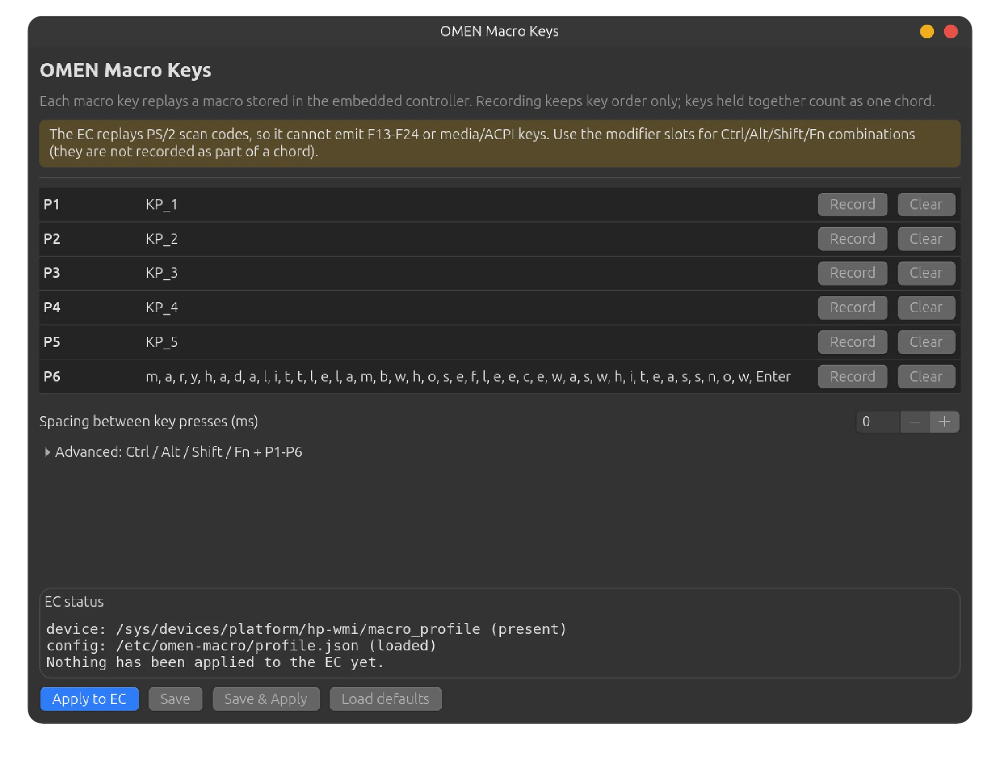

# OMEN macro keys (P1-P6) on Linux

Makes the six macro keys on the left edge of an HP OMEN 17 keyboard work in
Ubuntu, with a GUI to record and edit your own macros.

Developed and tested against **HP OMEN 17-ck2xxx** (DMI board `8BAD`),
Ubuntu 26.04, kernel 7.0.0-43, with the `hp-omen-extra` 2.1.2 DKMS package.

---

## Why the keys don't work out of the box

The P-keys are **not** connected to the keyboard controller. The embedded
controller (EC) keeps a 4096-byte table of PS/2 scan-code sequences; when you
press a P-key the EC replays the sequence stored in its slot. Until that table
is written, a P-key press produces **no input event at all** - so no userspace
remapper (`keyd`, `xbindkeys`, OMEN Space, …) can ever bind them.

HP's Windows *OMEN Gaming Hub* fills the table through two ACPI/WMI queries and
then enables the engine. That was reverse engineered by Lan Tian in 2022
([write-up](https://lantian.pub/en/article/modify-computer/reverse-engineered-linux-driver-for-hp-omen-macro-keys.lantian/),
[code](https://github.com/xddxdd/hp-omen-linux-module)); the technique was
carried forward to kernel 7.0 by
[FamleeX/hp-omen-cm2047nr](https://github.com/FamleeX/hp-omen-cm2047nr) on
board `8BB0`, which sits in the same OMEN Command Center device-list entry
(`"Cybug" / "OMEN 17"`, SSID `8BAD`) as this machine.

| Approach | Works on 8BAD? |
|---|---|
| Mainline `hp-wmi` | no macro support at all |
| `pelrun/hp-omen-linux-module` | RGB/keyboard backlight only, [issue #18](https://github.com/pelrun/hp-omen-linux-module/issues/18) still open |
| OMEN Space / `hp-omen-extra` | RGB + fan + thermal only; its "macro" is a passive evdev listener for the OMEN key |
| `sa4zet/hp.omen.kernel.patch` | macro code, but old kernels (6.8-6.10) |
| **this project** | ports the published technique onto the DKMS driver you already run, adds a writable interface + GUI |

---

## What gets installed

### Kernel side - `kernel/hp-wmi-macro.patch`

Adds to `hp-wmi` (the DKMS module in `/usr/src/hp-omen-extra-2.1.2`):

| sysfs file | mode | purpose |
|---|---|---|
| `/sys/devices/platform/hp-wmi/macro_profile` | write-only, 4096 B | write the whole table; the write uploads it (WMI query 15) and enables the engine (query 23) |
| `/sys/devices/platform/hp-wmi/macro_status` | read-only | last WMI return codes: `profile_write_ret`, `mode_set_ret`, `applied` |

The driver does no encoding; it just transports the buffer. That keeps all
policy in userspace where it can be edited without rebuilding a module.

### Userspace - `omen_macro/`

* `codec.py` - scan-code table, chord/delay encoder, profile builder, decoder
  for UI summaries. Pure stdlib, unit-tested.
* `apply.py` - CLI: upload the active profile, one named profile, the stock
  numpad layout, or a blank table; `--list-profiles`, `--dry-run`, `--status`.
* `gui.py` - GTK4 app ("OMEN Macro Keys") with key recording, per-key macros
  and commands, named profiles, optional auto-switch, and EC status readout.
* `profiles.py` - named-profile store shared by the GUI, the CLI and the
  boot service (`profiles/<name>.json` plus an `active-profile` pointer).
* `auto_switch.py` - optional per-user daemon: switches profiles with the
  focused app. Off unless enabled in the GUI.
* `ec.py` - the 4096-byte EC upload helper both upload paths share.

### Table format (for anyone extending this)

30 slots in EC order: `P1…P6`, `Ctrl+P1…P6`, `Alt+P1…P6`, `Shift+P1…P6`,
`Fn+P1…P6`, then one extra `0x01`. Each slot is `[len][bytes…]` where `len`
counts itself, an unused slot is the single byte `0x01`, release codes are
`make | 0x80`, `0xFF,ms` is a delay, and extended keys carry a `0xE0` prefix.
The stock layout maps `P1…P6` to numpad `1…6`.

---

## Install

```bash
cd omen-macro
sudo ./install.sh
```

The installer backs up `hp-wmi.c`, patches it, rebuilds/reinstalls the DKMS
package, reloads `hp_wmi`, installs the userspace tools, adds the udev rule,
the boot service and the (opt-in) per-user auto-switch service, and uploads
the active profile. First run seeds a Default numpad profile, migrating a
legacy `profile.json` if you have one.

**Verify:** press `P1` - it should type a numpad `1`. Or:

```bash
sudo libinput debug-events --show-keycodes # expect KEY_KP1
omen-macro-apply --status # expect applied=1
```

**If nothing happens:** reboot once (the old module may have still been
resident during the first upload) and check `omen-macro-apply --status`.

## Use

```bash
omen-macro # GUI (also "OMEN Macro Keys" in the app grid)
```



Click **Record** on a key, type the sequence, press **Stop**. Recording
captures *key order only*; the "Spacing between key presses" spinbox sets the
delay inserted between keystrokes when the EC replays them. **Every change
saves the current profile and sends it to the keyboard immediately** - there
is no separate save step, and the boot service re-applies the active profile
after a restart.

### Profiles

The profile switcher sits at the top of the window. New creates a profile as
a copy of the current one, Rename renames it, Delete removes it (the last
profile cannot go). Switching profiles applies that profile at once. The old
single `profile.json`, if you have one, is imported as Default on first run.

CLI equivalents:

```bash
omen-macro-apply # upload the active profile
omen-macro-apply --profile Gaming # upload one profile without switching
omen-macro-apply --list-profiles # show profiles (* marks the active one)
omen-macro-apply --default # stock numpad layout
omen-macro-apply --clear # all slots empty
omen-macro-apply --dry-run # encode + summarise, touch nothing
```

### Per-key commands (run a program instead of typing)

Every P-key row and the OMEN row have a command option alongside the macro:

- P1-P6: the Cmd button binds KP_1-KP_6 to any command you type. While a
  command is set, that key's typing macro is left out of the EC upload, so the
  key runs the command instead of typing. Fn+P combinations still replay their
  own slots. Note: a USB keyboard with a real numpad sends the same keysyms,
  so it would also trigger these shortcuts.
- OMEN (logo key): the logo key is not an EC macro slot. It always sends
  KEY_PROG2 (XF86Launch2), so there is nothing to upload. Set opens a dialog
  for the command it should run (default `omen-macro`), Clear removes the
  shortcut.

The GUI owns one GNOME custom shortcut per configured key and leaves your
other shortcuts alone. Commands live in the profile under `commands` and
survive reboot like the macros. Older files using `omen_key` still load.

### What the buttons do

The footer buttons are deliberately few: everything else applies itself.

- Re-apply: re-sends the current profile to the keyboard and shortcuts
  (recovery if the keys stop responding).
- Load defaults: replaces this window with the stock numpad layout, saved
  and sent immediately.

### Auto-switch profiles (optional, off by default)

A per-user background service watches the focused app and switches profiles
for you - for example a Gaming profile while a game is focused, back to
Default otherwise. Matching is a case-insensitive substring of the app name
and window title; the first rule wins. Your manual switches always win until
focus moves again: the daemon only acts when the focused *application*
changes.

Set it up in the GUI under "Auto-switch profiles": flip the switch on, add
rules (app text plus profile), pick the fallback profile for when nothing
matches, and use Refresh to see what the daemon currently sees focused. The
service logs to the journal:

```bash
journalctl --user -u omen-macro-auto.service
```

It needs a running desktop with accessibility services (standard on GNOME)
and does nothing when they are unavailable.

## Limitations

* The EC replays **PS/2 scan code set 1**. Keys without such a code cannot be
  emitted: `F13`-`F24`, media/volume/brightness keys, and most
 `XF86…` keys. The GUI reports these instead of silently dropping them.
* One entry may hold at most 254 payload bytes - roughly 60 keystrokes,
 less with delays.
* Spacing is 0-2040 ms (the EC's delay marker is one byte, so it is split into
 255 ms chunks).
* The EC forgets the table on a cold boot, hence the systemd oneshot service.
* Modifier variants (`Ctrl+P1`, …) are separate EC slots. If they are left
 empty, pressing e.g. `Ctrl+P1` does whatever the base `P1` macro does with
 Ctrl held.

## Revert

```bash
sudo ./revert.sh
```

Clears the EC table, restores the backed-up `hp-wmi.c`, rebuilds the DKMS
module, and removes the udev rule, services and installed binaries. The config
directory (`/etc/omen-macro`) is kept.

## Troubleshooting

| Symptom | Cause / fix |
|---|---|
| `macro_profile` missing | patched module not loaded - `dmesg \| grep macro`, or reboot |
| `permission denied` writing | udev rule/permissions - `sudo ./fix-boot.sh`, or `sudo chmod 0220 …` |
| `macro_status` shows non-zero `profile_write_ret` | the EC rejected the upload; the keys stay disabled and nothing breaks. Report the code |
| `ENODEV` / `EIO` on write | driver could not reach the EC via WMI (query 15 unsupported on this firmware) |
| Keys dead after reboot, then work a minute later | the boot unit ran late. Fixed by `fix-boot.sh`; see "Boot timing" below |
| Keys dead after reboot and stay dead | `systemctl status omen-macro-apply` / `journalctl -b -u omen-macro-apply` |

### Boot timing

The EC forgets the table on every cold boot, so `omen-macro-apply.service`
re-uploads it. Two ordering pitfalls, both fixed in the shipped unit:

* Do **not** put `After=multi-user.target` on it. Userspace can take minutes
 here; the driver is ready ~5 s after boot, and the keys stay dead until the
 upload happens. The unit intentionally runs as soon as `basic.target` is
 reached.
* The `macro_profile` attribute is created in the driver's probe, which can be
 later than udev's `add` event for the platform device. A udev rule with
 `TEST=="macro_profile"` therefore silently fails, which is why the shipped
 rule waits for the file and the unit's `ExecStartPost` also fixes the group.

`sudo ./fix-boot.sh` applies just those two fixes (unit + udev rule +
permissions, no module rebuild). Re-running `install.sh` is also safe but
slower, because it rebuilds the DKMS package.


## Tests

```bash
python3 tests/test_codec.py # encoder format tests, no hardware needed
python3 tests/test_profiles.py # profile store, migration, active pointer
python3 tests/test_omen_key.py # shortcut helpers (plus a read-only live check)
python3 tests/test_auto_switch.py # focus matcher, rules file (plus live probe)
python3 -m omen_macro.gui --selftest # recording + encoder + profiles + matcher
```

## Credits

Lan Tian (reverse engineering, write-up), `xddxdd` and `pelrun` (Linux
driver work), `FamleeX` (kernel-7.0 forward port), `yunusemreyl` (the
`hp-omen-extra`/OMEN Space stack this builds on).
