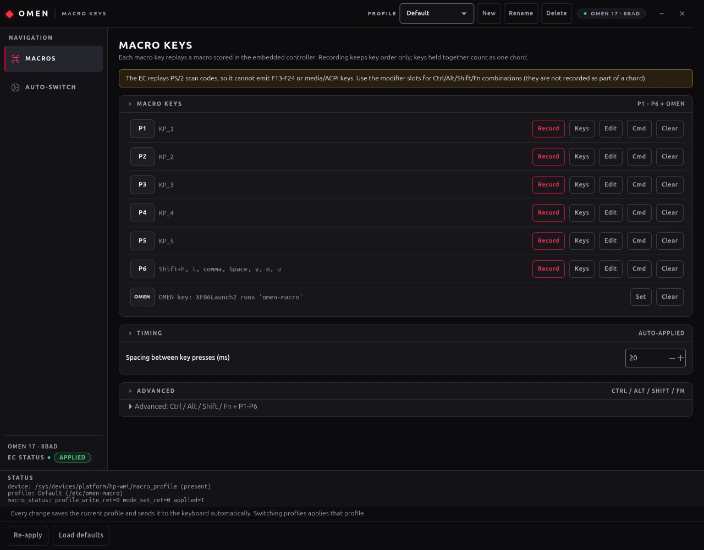

# OMEN Macro Keys

Make the six macro keys (P1–P6) on an HP OMEN laptop work on Linux, and choose
what each one types.



## What it does

* **Turns the six side keys into normal keys** that can type anything.
* **Record a macro** by pressing the keys you want.
* **Fix a macro by hand** when recording gets a step wrong — no need to start
  over.
* **Run a command instead of typing**, per key.
* **Keep several profiles** and switch them automatically with the focused app.

## Install

You need Ubuntu on an HP OMEN laptop, and the `hp-omen-extra` driver package
(it is usually already there). Then:

```bash
cd omen-macro
sudo ./install.sh
```

It takes a few minutes because it builds a kernel module. Afterwards press
`P1` — it should type a numpad `1`.

* **Secure Boot is on?** The keys will stay dead until you do one extra
  two-minute step: [Secure Boot](docs/SECURE-BOOT.md).
* **Nothing happens?** Reboot once, then read
  [Troubleshooting](docs/TROUBLESHOOTING.md).
* **Want the details?** [Install guide](docs/INSTALL.md).

## Use

```bash
omen-macro
```

The window is also in the app grid as **OMEN Macro Keys**.

* Click **Record**, press the keys, click **Stop**.
* Click **Edit** to fix one step of a macro (a typo, or two keys that were
  recorded as one). Press **Split** to turn `h+e` into `h` then `e`.
* Use the profile box in the title bar to add, rename or switch profiles.
* Click **Cmd** to run a program when a key is pressed instead of typing.
* The **Auto-switch** page can change profile when you change apps (off by
  default).

Every change is saved and sent to the keyboard immediately. Full walkthrough:
[Using the app](docs/USING-THE-APP.md).

## Update or remove

```bash
sudo ./install-userspace.sh   # update only the app: no rebuild, no reboot
sudo ./revert.sh              # remove everything (profiles are kept)
```

## More documents

| Document | What is in it |
|---|---|
| [Install guide](docs/INSTALL.md) | install, update, remove, files and folders |
| [Using the app](docs/USING-THE-APP.md) | recording, editing, profiles, commands, auto-switch |
| [Secure Boot](docs/SECURE-BOOT.md) | why the module is rejected and how to enrol the key once |
| [Troubleshooting](docs/TROUBLESHOOTING.md) | symptoms, logs, boot timing |
| [How it works](docs/HOW-IT-WORKS.md) | the keyboard table, kernel patch, internals |
| [Developing](docs/DEVELOPING.md) | tests, visual QA harness, UI style |

## Credits

Lan Tian (reverse engineering and write-up), `xddxdd` and `pelrun` (Linux
driver work), `FamleeX` (kernel 7.0 port), `yunusemreyl` (the
`hp-omen-extra`/OMEN Space stack this builds on).

Tested on an HP OMEN 17-ck2xxx (board `8BAD`), Ubuntu 26.04, kernel 7.0.0-43.
