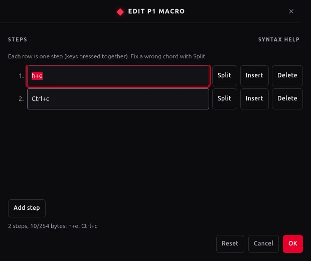

# Using the app

Open the app from the app grid (**OMEN Macro Keys**) or run:

```bash
omen-macro
```

Every change is saved and sent to the keyboard straight away. There is no
"Save" step. After a reboot the boot service sends your active profile again.

The window has two pages, picked in the left sidebar:

* **Macros** – the six macro keys and their settings.
* **Auto-switch** – optional: change profile depending on the focused app.

The status bar at the bottom always shows what the app is doing, and the
sidebar shows whether the keyboard accepted the last upload (`APPLIED`).

---

## Recording a macro

1. Click **Record** on a key (P1–P6).
2. Press the keys you want, in order.
3. Click **Stop** (or press `Esc`).

Recording keeps **key order only**. Keys held at the same time count as one
"step" — so `Ctrl` then `C` becomes `Ctrl+C`, not `Ctrl` then `C`.

**Spacing between key presses** sets the delay the keyboard puts between
steps, from 0 to 2040 ms. 20 ms is a good default.

Some shortcuts never reach the window because the desktop handles them first
(for example `Ctrl+Alt+T` opens a terminal). For those, use **Keys** and pick
the modifiers and key by hand.

---

## Editing a macro by hand

Fast typing can make the app think two keys were pressed together when they
were really one after the other. You do not need to record the macro again:
click **Edit** on the row and fix only the step that is wrong.

Each row is one **step** — the keys the keyboard presses together.

| You type | You get |
|---|---|
| `Ctrl+Shift+t` | one step: Ctrl, Shift and t together |
| `h e` or `h, e` | two steps: h, then e |
| `"Hi!"` | literal text: `H`, `i`, `!` (Shift is added for you) |
| `Ctrl` `Enter` `KP_1` | key names, upper or lower case |

* If a step was recorded as one chord but should be two steps, click **Split**
  (it turns `h+e` into `h` then `e`), or just retype the row.
* **Insert** adds an empty step after a row. **Delete** removes a step.
  **Add step** adds one at the end.
* A row may hold several steps: typing `h e l l o` creates five steps.
* Wrap text in double quotes to type it literally: `"Hi, you"` types
  `Shift+h`, `i`, `,`, space, `y`, `o`, `u`. Capitals and shifted symbols
  (`!`, `?`, `:` …) get Shift automatically (US layout).
* Key names ignore case and accept the names the window shows (`Ctrl`,
  `Shift`, `Alt`, `Super`, `Enter`, `Esc`, `Space`, `Tab`, `Backspace`,
  `PgUp`, arrows, `KP_1`, `Num+`) or the canonical names (`Control_L`).
* The line under the list shows the size of the macro against the keyboard's
  254-byte limit. **OK** saves and sends it; **Reset** restores the last saved
  version; **Cancel** closes without changes.
* Click **SYNTAX HELP** in the dialog to see the same reference any time.



**Keys** is the quick way to build a shortcut from scratch. **Edit** is for
repairing a macro that already exists.

---

## Profiles

A profile is a full set of macros. Use the profile box in the title bar:

* **New** – copy the current profile under a new name.
* **Rename** – rename it.
* **Delete** – remove it (asks first; the last profile cannot be deleted).

Switching profiles sends that profile to the keyboard immediately.

The command line can do the same things:

```bash
omen-macro-apply                    # send the active profile
omen-macro-apply --profile Gaming   # send one profile without switching
omen-macro-apply --list-profiles    # list profiles (* = active)
omen-macro-apply --default          # stock numpad layout
omen-macro-apply --clear            # empty every slot
omen-macro-apply --dry-run          # show what would be sent
omen-macro-apply --status           # read the last keyboard return codes
```

---

## Running a command instead of typing

Each P-key and the OMEN key can run a program instead of typing a macro.

* **P1–P6** – click **Cmd** and type a command. While a command is set, that
  key runs the command and its typing macro is not sent to the keyboard.
  Fn+P combinations still use their own macros.
* **OMEN key** (the logo key) – it does not use a macro slot at all. Click
  **Set** and type the command it should run (default: `omen-macro`).

The app adds one GNOME keyboard shortcut per configured key and leaves your
other shortcuts alone. Commands are stored in the profile, so they survive a
reboot.

> Note: a USB keyboard with a real numpad sends the same keys, so pressing its
> `1`–`6` also triggers P-key commands.

---

## Footer buttons

* **Re-apply** – send the current profile again (use this if the keys stop
  responding).
* **Load defaults** – replace the profile with the stock numpad layout
  (asks first).
* **Stop recording** – appears only while recording.

---

## Auto-switch profiles (optional, off by default)

A small background service can switch profiles for you. For example, use a
`Gaming` profile while a game is focused and go back to `Default` otherwise.

Set it up on the **Auto-switch** page:

1. Turn the switch on.
2. Add rules: some text from the app or window title, and the profile to use.
   Matching ignores case and looks for the text anywhere in the name; the
   first matching rule wins.
3. Pick the fallback profile for when no rule matches.
4. **Refresh** shows what the service currently sees in focus.

Manual profile changes always win until you switch to a different app. Logs:

```bash
journalctl --user -u omen-macro-auto.service
```

It needs a normal desktop session (accessibility services, standard on GNOME).
When they are not available the service simply does nothing.

---

## What the keys cannot type

The keyboard chip can only replay **PS/2 scan codes**, so some keys cannot be
emitted at all: `F13`–`F24`, media/volume/brightness keys and most `XF86…`
keys. The app tells you when a key cannot be used instead of silently dropping
it. There is also a size limit of 254 bytes per macro — roughly 60
keystrokes, fewer with delays.

See [how it works](HOW-IT-WORKS.md) for the details.
